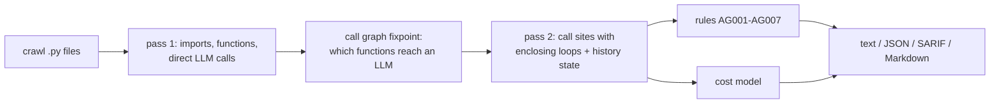

# AgentGuard

[](https://github.com/muaz-q/AgentGuard/actions/workflows/ci.yml)
[](https://pypi.org/project/agentguard-cli/)
[](https://pypi.org/project/agentguard-cli/)
[](LICENSE)

**A static analyser that finds the code patterns that make LLM agents expensive - before they run.**

Agent bills rarely blow up because of one expensive call. They blow up because of loops: an
agent that stops only when the model says so, a conversation history that is re-sent in full
on every turn, a call buried three functions deep inside a loop over a dataset. AgentGuard
reads your Python (it never runs it or calls an API), finds those patterns with file and line,
and estimates what a run costs.

```console
$ agentguard examples/research_agent.py
examples/research_agent.py:21:13: AG006 [low] LLM call (openai.chat) sets no output-token cap
examples/research_agent.py:31:17: AG001 [high] LLM call (anthropic.messages) inside `while` loop (line 28) with no iteration cap
examples/research_agent.py:31:17: AG002 [high] LLM call (anthropic.messages) re-sends a history that grows every iteration; input tokens grow quadratically
examples/research_agent.py:31:17: AG007 [medium] ~2,260-token static prompt re-sent each iteration with no `cache_control`
examples/research_agent.py:47:13: AG003 [medium] call to `summarise` inside 2 nested loops (lines 45, 46); calls multiply

5 finding(s) (2 high, 2 medium, 1 low) in 1 file(s), 3 LLM call site(s).

Estimated cost per run
  loops with no constant bound evaluated at N = 1, 10, 100
  N=1          $0.0082 - $0.02        (2 calls, 5,760 tokens at most)
  N=10           $0.21 - $0.49        (110 calls, 305,100 tokens at most)
  N=100         $14.88 - $36.40       (10,100 calls, 27,801,000 tokens at most)

Largest cost drivers (at N=100, high end)
        $20.00  examples/research_agent.py:47 -> summarise()
        $16.40  examples/research_agent.py:31 anthropic.messages [claude-sonnet-5-5]

  assumptions: 500 system + 500 input tokens per call, 200-1000 output tokens; default model claude-sonnet-5-5; prices as of 2026-10-11
```

(Each finding also prints its fix; trimmed here.) [`examples/research_agent_fixed.py`](examples/research_agent_fixed.py)
is the same agent with every finding fixed.

## Does it work?

Checked two ways, both reproducible from [`bench/`](bench/):

**Findings on real code.** AgentGuard was run on 22 well-known open-source agent projects
(1.9M lines) at pinned commits, and **every finding was checked by hand** against the source
([`bench/labels.csv`](bench/labels.csv)). The projects were split in two: 14 were used while
developing the rules, and false positives found there were fixed; the other 8 were only
looked at after the rules were frozen. The hold-out number is the honest one.

| | Projects | Lines | Findings | Correct |
|---|---|---|---|---|
| Tuning set (first review, before fixes) | 14 | 803k | 50 | 44 (88%) |
| **Hold-out set (rules frozen)** | **8** | **1.11M** | **36** | **33 (92%)** |

Correct findings include the history growth in OpenAI's own [swarm](https://github.com/openai/swarm/blob/6af0b4caf37dca4526dfd98e9fbd8ce36e7eeb22/swarm/core.py#L260)
`run()` loop, whose turn limit defaults to infinity. The misses, and what each rule gets
right, are in [docs/benchmarks.md](docs/benchmarks.md).

**The cost model against measured tokens.** A real chat agent that keeps its whole history
([`bench/ollama_agent.py`](bench/ollama_agent.py)) was run for 40 turns on a local model, and
AgentGuard - given only the first two turns' sizes - predicted the cumulative input tokens of
every later turn:

| Run | Turns | Measured input tokens | AgentGuard | Naive (N x first call) |
|---|---|---|---|---|
| Constant sizes (every reply hits a 64-token cap) | 10 | 4,495 | 4,495 (+0.0%) | 580 (-87.1%) |
| Constant sizes (every reply hits a 64-token cap) | 40 | 70,180 | 70,180 (+0.0%) | 2,320 (-96.7%) |
| Constant sizes (every reply hits a 128-token cap) | 10 | 7,430 | 7,430 (+0.0%) | 590 (-92.1%) |
| Constant sizes (every reply hits a 128-token cap) | 40 | 120,920 | 120,920 (+0.0%) | 2,360 (-98.0%) |
| Varied sizes (questions of different lengths, replies end naturally) | 10 | 13,833 | 12,360 (-10.7%) | 570 (-95.9%) |
| Varied sizes (questions of different lengths, replies end naturally) | 40 | 232,760 | 206,640 (-11.2%) | 2,280 (-99.0%) |

In the realistic run AgentGuard was 11% low at 40 turns (mean error 10.9% over turns 3-40,
worst 24.3% early on), the error coming from two calibration turns that were shorter than
average. The naive estimate - "N calls times the first call's size", what you get from a
spreadsheet - was 99% low: it is linear in the number of turns, while turn *k* re-sends all
*k - 1* earlier turns.

## Install

```bash
pip install agentguard-cli
agentguard .                    # scan the current project
```

Python 3.9+. No runtime dependencies (`tomli` on 3.9/3.10).

## Use it in CI

**GitHub Action** - findings appear in the Security tab and as PR annotations, the report in
the job summary:

```yaml
# .github/workflows/agentguard.yml
on: [push, pull_request]
jobs:
  agentguard:
    runs-on: ubuntu-latest
    permissions: { contents: read, security-events: write }
    steps:
      - uses: actions/checkout@v4
      - uses: muaz-q/AgentGuard@v0.3.0
        with:
          fail-on: high        # high | medium | low | never
```

**pre-commit:**

```yaml
- repo: https://github.com/muaz-q/AgentGuard
  rev: v0.3.0
  hooks:
    - id: agentguard
```

Exit status is 1 when a finding is at or above `--fail-on` (default `high`), 0 otherwise, 2
on an error.

## Use it from a coding agent (MCP)

AI coding agents write a lot of agent code. AgentGuard ships an MCP server so they can check
their own work: a `scan` tool that returns the findings and cost estimate as JSON, and
`explain_rule`. Both are read-only.

```bash
pip install "agentguard-cli[mcp]"                 # Python 3.10+
claude mcp add agentguard -- agentguard-mcp       # Claude Code; any MCP client works the same way
```

## Rules

| Rule | Severity | Finds |
|---|---|---|
| [AG001](docs/rules.md#ag001) | high | an LLM call in a loop with no iteration cap |
| [AG002](docs/rules.md#ag002) | high | a history that grows each iteration and is re-sent (quadratic input) |
| [AG003](docs/rules.md#ag003) | medium | an LLM call inside nested open-ended loops |
| [AG004](docs/rules.md#ag004) | low | one LLM call per item of a collection |
| [AG005](docs/rules.md#ag005) | high | a function that makes LLM calls and recurses with no depth limit |
| [AG006](docs/rules.md#ag006) | low | a call with no output-token cap |
| [AG007](docs/rules.md#ag007) | medium | a large static prompt sent to Anthropic in a loop without caching |

What it understands: the OpenAI, Anthropic, Gemini (`google-genai`, `google-generativeai`),
LiteLLM and Ollama SDKs; LangChain chat models, chains (`prompt | llm`) and `bind_tools`;
calls reached through helper functions, methods and imports in other files; loop bounds
from literals, module constants, step counters, countdowns and retry helpers; and history
trimming (`messages[-k:]`, summarisation) that makes growth safe.

Silence a finding with `# agentguard: ignore[AG006]` on its line, or a whole file with
`# agentguard: ignore-file`.

## The cost estimate

Each call site is priced at the model named in the code (falling back to `--model`). Loops
with a constant bound use it; loops whose size is only known at run time are evaluated at
several assumed iteration counts (`--depths`, default 1, 10, 100). For a history that grows,
turn *k* re-sends the *k - 1* earlier turns, so over *n* turns:

```
input  = n*S + U*n(n+1)/2 + O*n(n-1)/2        S = static prompt, U = new input per turn,
output = n*O                                  O = output per turn
```

`S` is measured from the prompt in the code when it is a static string; otherwise `S`, `U`
and the `O` range are assumptions (`--system-tokens`, `--input-tokens`, `--output-tokens 200:1000`).
Anthropic calls that use `cache_control` have the static prefix billed at the cache-read rate.
Prices are bundled with an `as_of` date (`agentguard --list-models`); pass `--prices` with a
file in the same format or [LiteLLM's price map](https://github.com/BerriAI/litellm/blob/main/model_prices_and_context_window.json)
to update them.

The estimate is a range for planning, not a bill: it cannot know how often a branch is taken
or how long a real reply is. The findings are the main output.

## Output and configuration

`--format text | json | sarif | markdown`, `-o FILE`. JSON has a versioned schema; SARIF 2.1.0
works with GitHub code scanning and most IDE SARIF viewers.

```toml
# pyproject.toml
[tool.agentguard]
exclude = ["tests/*", "scripts/*"]
ignore = ["AG004"]
fail_on = "medium"
model = "gpt-4.1-mini"
```

## How it works



Pure `ast`, two passes per file. The first pass learns each module's imports, functions,
client objects (`client = OpenAI()`, `llm = ChatOpenAI(...)`, `chain = prompt | llm`) and
which functions call a model directly; a fixpoint over the project call graph then finds
every function that reaches a model through others. The second pass records each call site
with its enclosing loops - classified as fixed, capped, data-driven, interactive or
unbounded - and tracks which variables grow, and which are trimmed, inside each loop.
About 12,000 lines per second on a laptop; files that cannot reach a model skip the second pass.

## Limitations

- Python only. Calls made through dynamic dispatch (`getattr`, plugin registries, a
  provider chosen at run time) are not followed; frameworks that wrap the SDK in their own
  abstractions are seen only where the wrapper makes the SDK call.
- A loop paced by external events - a websocket server, a queue consumer - is reported as
  unbounded. `input()` and prompt libraries are recognised; servers are not.
- The cost model assumes every call site runs once per scenario; it does not model branch
  probabilities.

## Development

```bash
pip install -e ".[dev]"
pytest && ruff check . && mypy
python bench/real_world.py --set holdout       # re-run the precision benchmark
python bench/validate_cost_model.py            # needs a local Ollama with llama3.2
```

See [CONTRIBUTING.md](CONTRIBUTING.md). MIT licensed.
